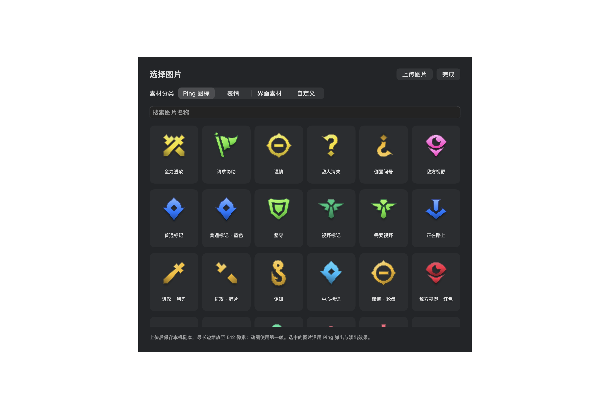
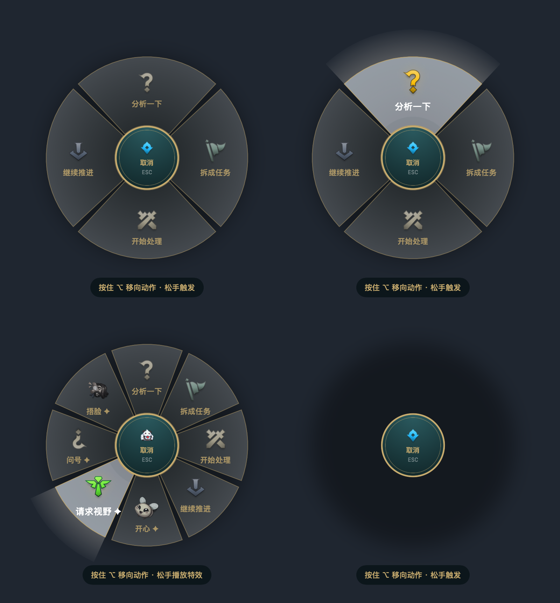
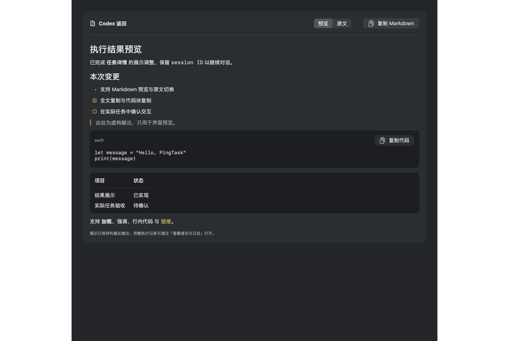
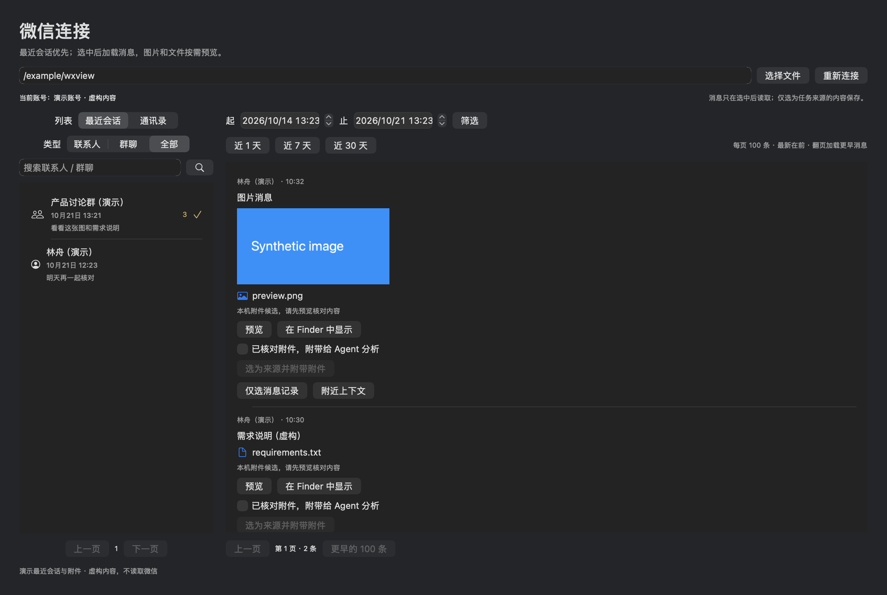
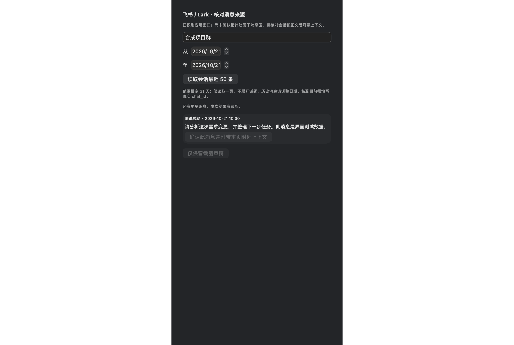

# PingTask

**指向信息，表达意图，让事情往前推进。**

一个使用 SwiftUI + AppKit 构建的原生 macOS 应用。按住 Option（Alt）/ Ctrl / 自定义组合键，或按住鼠标右键拖动，选择 Ping 意图，松手保存截图草稿；也可以只播放一个短暂的特效。

已实现全局轮盘、窗口截图、Vision OCR、wxview 消息定位和本地任务管理。**已接入 tmux + Codex CLI：真实来源确认后可启动执行并找回 session。WorkBuddy 已加入实验性 CLI + IPC 适配；虚构消息练习仍为模拟。**


> 图片由当前原生界面离屏渲染，使用隔离存储和虚构消息，不包含真实聊天或桌面截图。图片展示不代表全局权限、真实截图和动态效果已完成实机验收。

## 五个功能入口

| 页面 | 用途 |
|---|---|
| 桌面 Ping | 开启全局手势，查看已启用意图、预览特效，核对捕获来源和最近任务 |
| 任务记录 | 搜索、筛选、编辑草稿、明确提交、续接、取消和删除；Codex 返回 Markdown 预览、原文与快速复制 |
| Ping 意图 | 新增、搜索、排序和删除意图，配置图片、行为与提示词，设置轮盘中心图与新意图默认图标 |
| 微信连接 | 检查本机 wxview，按会话与日期查找消息，手动选为任务来源 |
| 设置 | 配置 Option / Alt、Ctrl、自定义快捷键或鼠标右键拖动，管理系统权限、查看执行器状态和本地数据 |

金色问号用于应用 Logo、Dock 和菜单栏；菜单栏使用独立的 **18 × 18 pt** 图标。界面采用石墨灰与金色，默认进入桌面 Ping。虚构消息的交互练习放在设置底部。

设置 → 应用显示可开启“仅在菜单栏显示（隐藏 Dock 图标）”，即时生效并记住选择。关闭窗口后仍在后台运行，可从顶部小图标的“打开 PingTask”重新打开；关闭此选项恢复 Dock 图标。

<details>
<summary>Ping 意图库、图片选择与轮盘</summary>






</details>

<details>
<summary>任务记录：来源、确认与推进</summary>




</details>

<details>
<summary>微信连接与设置</summary>


设置截图为此前版本；当前“触发方式”已增加鼠标右键拖动和自定义快捷键录入。

</details>

## 安装与运行

要求 macOS 13+、Swift 6.0+ 工具链和 macOS SDK（Xcode 或 Command Line Tools）。macOS 13 的截图兼容性仍需实机验证。

```sh
git clone https://github.com/auenger/PingTask.git
cd PingTask
bash scripts/package-app.sh
open dist/PingTask.app
```

开发时可以执行 `swift run PingTask`。打包脚本生成当前机器架构的应用和问号 icns，使用本机 ad-hoc 签名；尚未提供 Universal 包、Developer ID 签名、公证或自动更新。

## 使用方式

### 桌面 Ping

1. 在“设置”选择 **Option / Alt**、**Ctrl / Control**、**鼠标右键拖动** 或 **自定义快捷键**，授权辅助功能。任务意图截图还需要屏幕录制权限；纯特效意图无需该权限。
   Option 与 Alt 是同一个键；选择“自定义快捷键”后点“录入快捷键”，按一个包含 Control、Option 或 Command 的组合键（可叠加 Shift），设置会保存。
2. 回到“桌面 Ping”开启全局 Ping。系统要求时重启应用；本地开发包更新后可能需要重新授权。
3. 指向信息，按住触发键并移动选择动作，松手触发。回中心、Esc 或其他按键取消；键盘模式也可用右键取消，右键拖动模式可用左键取消。自定义组合键需先松开主键触发，提前松开修饰键会取消；启用后由 PingTask 接管该组合键。其他组合键继续传递给当前应用。右键模式需拖动超过 10 点才进入轮盘，捕获锚点保留按下位置；普通右键点击在松开时打开菜单，此模式会接管应用原有的右键拖动。
4. **任务意图**松手时也播放对应图标的弹出、扩散环和约 2.2 秒的留存淡出，图标下方独立显示捕获进度（屏幕底部时移至上方）。同时保存目标窗口截图，通过 OCR 和已配置的 wxview 检索消息候选；特效与进度浮层不进入目标窗口截图。核对来源后形成可提交草稿；找不到消息时可明确保留截图来源。
5. **仅播放特效**只展示图标弹出、扩散环和约 2.2 秒的留存淡出，不截图、不 OCR、不查询微信、不创建任务。意图页的“预览特效”同样不创建任务。

默认四个意图为“分析一下、拆成任务、开始处理、继续推进”。意图库支持新增、搜索、编辑、排序和删除；轮盘按启用数量分区，最多同时启用 8 个，未启用的意图保留在库中。新意图默认仅播放特效，可切换为任务并配置提示词。删除意图不删除历史任务，修改不覆盖已有任务快照。

图片选择器提供 lolPing 的 32 张 Ping 图标、44 张表情图和 19 张界面图，支持分类、搜索及上传 PNG / JPEG / HEIC / GIF / WebP / TIFF。导入上限 20 MB、边长 8192 像素，转为最长边 512 像素的 PNG 副本保存在 `Artwork/`，动图取第一帧。自定义图片可删除，正在使用的图片需先更换。可设置新意图默认图标、独立更换轮盘中心图并恢复默认；中心区域始终用于取消。窗口边缘会调整轮盘和选择指针，结束后恢复原始指针；捕获锚点始终保持按下时的位置。

### 微信连接

1. 选择支持 `messages --order / --cursor` 的本机 `wxview`，启动时自动加载最近会话，不逐个查询聊天历史。已对照本机 `0.4.0-pagination-dev`；旧 CLI 提示升级。
2. 最近会话按最新消息时间倒序，每页 100 个，显示时间、摘要和未读数量；可筛选联系人/群聊或切换通讯录。缓存变化时会话位置可能变化，按 ID 去重，刷新从第一页重排。选中后读取范围内最新 100 条消息，“更早的 100 条”使用固定时间范围的游标继续。
3. 可直接选为 Ping 来源，或点击“查看附近上下文”：读取该会话目标消息前后 15 分钟内最多 100 条，核对锚点前后各最多 5 条后再确认。仅保存确认的材料，其他候选不落盘。

桌面自动定位只适用于微信窗口（`com.tencent.xinWeChat`）。默认检索最近 **30 天**，每次最多 **20 条**消息，可修改日期范围（最长 366 天）。唯一标题候选可以继续自动检索，但最终消息始终由用户核对；OCR 相似度不是权威消息身份。

wxview 使用本地缓存，不保证实时或手机端完整性。当前仅支持单账号目录，查询前后复核身份。不会自动初始化密钥、读取微信进程内存、启动无关服务或推进共享 checkpoint；缓存缺失时 wxview 自身可能按其规则建立缓存。来源正文上限 12000 字。

本机可用的图片按需加载缩略图，图片和文件支持 Quick Look 预览、Finder 定位。仅允许读取当前账号目录或缓存中的普通文件，单个附件最多 32 MB；找不到本地文件时显示提示，不自动从 CDN 下载。wxview 部分文件定位依赖候选匹配，请先预览核对，再勾选“附带给 Agent 分析”并选择 Ping 意图。



创建草稿时保存独立附件副本和 SHA-256，提交前再次校验，并把附件复制进本次提交目录；提示词列出文件清单和分析要求。Codex 图片转换为 PNG 提供视觉输入，WorkBuddy 通过额外目录访问读取附件，图片理解尚未验证。附件内容只作为资料，不作为执行指令。重复 Ping 保留已有附件；删除任务清理独占副本，共享文件保留，已提交的执行快照仍保留。

### 任务与记录

- 松手不自动派发；真实来源明确确认后交给 Codex CLI。虚构消息练习使用模拟执行器。
- 同一来源、动作 ID、执行器再次 Ping，打开已有记录并保留编辑；已移除项目选择和项目身份维度。
- 活跃提交期间重复点击不会生成新一轮；续接必须添加新信息并明确确认。
- 模板变更只影响新草稿；历史提示词快照不变。
- 可以取消草稿或停止本地模拟。删除记录需要确认，独占截图移入废纸篓，共享截图保留；删除不代表取消远程任务。
- 重启发现未结束的模拟执行时标记“待核对”，不自动重新提交。

轮盘的“继续推进”是可配置意图；当前真正的模拟续接在已有任务记录中操作。不能把模拟完成当成真实执行、代码改动或验证完成。

## Codex CLI 接入

1. 在设置点击“自动查找”，或选择 Codex、tmux 可执行文件，再“检查连接”。沿用 Codex 自己的登录；连接检查与工作目录校验分开。
   App 自动创建 `~/Library/Application Support/PingTaskPrototype/Workspace` 作为默认工作目录，也可改为自己的项目目录。旧设置中的空目录会自动补齐，已有自定义目录保留。
2. 选择“只读分析”或“允许修改工作目录”。确认卡展示目录与权限；来源正文和最多 4 张截图会交给 Codex 当前配置的服务。
3. 在真实消息或截图草稿中点击“确认交给 Codex CLI”。独立 tmux 会话启动 `codex exec --json`，关闭 PingTask 不会中断执行。
4. 任务记录展示首次执行输出、状态、session ID 和更新时间。“打开 Codex CLI”在运行时连接原 tmux，结束后用 `codex resume <session-id>` 找回对话。
5. 后续在 Codex 中继续推进。当前 App 展示首次执行状态，外部续聊最新状态以 Codex 为准；Codex App 中的会话可见性与直达链接尚未验证。

执行完成不代表结果已验收。失联或缺少回执时标记“状态待核对”，不自动重新派发。非交互执行不能现场批准提权，遇到限制可在 CLI 中继续。执行中的记录禁止删除；已结束记录删除后，独立提交快照、日志和 Codex 会话仍保留。

详见 [CLI 交接实现与手动回归](docs/06-codex-cli.md)。

## 飞书 / 钉钉窗口来源

已加入飞书、Lark、钉钉窗口识别，以及飞书 CLI 路径/profile 设置。飞书可按精确群名或真实 chat_id 读取指定日期最近 50 条，由用户确认消息并附带本页附近上下文；不会自动提交。明确识别为输入控件时停止自动查询。钉钉消息适配仍待本机 dws 契约校验，目前保留截图草稿。详见 [接入状态与边界](docs/08-enterprise-chat.md)。



这是来源核对面板的独立预览，不代表真实飞书登录或消息读取已通过验收。

## 数据与边界

### 本轮开发状态

设置中可检查 WorkBuddy 桌面连接，Ping 意图可选择 Codex / WorkBuddy、自动上下文与自动提交，两个自动开关默认关闭。WorkBuddy 默认启用读取工具，可开启 Write / Edit，返回结果支持 Markdown 预览和复制；桌面任务列表、续聊及图片视觉输入尚未验证。详见 [WorkBuddy 接入与验证边界](docs/07-workbuddy.md)。

下文及前文的人工确认流程是默认行为；微信显式开启意图自动提交后采用预先授权，唯一可靠匹配才提交，歧义保留草稿，已有任务不重复派发。微信页已对接 wxview 倒序游标分页，真实聊天与 GUI 完整流程仍待验收。

记录保存在 `~/Library/Application Support/PingTaskPrototype/state.json`，截图位于同目录的 `Captures/`。旧目录名为兼容既有数据保留。设置中可以打开数据目录。

截图只在主动触发任务意图时进行；空闲不录屏、不运行 OCR、不轮询聊天。图像最长边 4096 像素，OCR 最多 400 行。macOS 14+ 使用 SCScreenshotManager，13 使用短时 SCStream 获取一帧。

任务和意图仍用 JSON，适合单实例本地使用；Codex 初次提交单独使用 SQLite 事务占用与不可变快照。尚无远端幂等承诺、外部续聊状态同步、完整历史上下文及完整的企业聊天适配（飞书已实现人工确认流程，钉钉仅读取窗口身份）。权限、焦点、多屏/Retina、macOS 13 和真实微信命中率仍需实机验收。

## 开发与验证

```sh
swift build
swift run PingTask --self-test
swift run PingTask --intent-check
bash scripts/package-app.sh
./dist/PingTask.app/Contents/MacOS/PingTask --self-test
./dist/PingTask.app/Contents/MacOS/PingTask --intent-check
codesign --verify --deep --strict dist/PingTask.app
plutil -lint dist/PingTask.app/Contents/Info.plist
```

测试使用临时存储与合成消息，覆盖身份、去重、编辑保留、提交保护、取消与删除、共享截图清理、wxview 协议和账号隔离、CLI 超时、手势状态、来源确认及真实 Vision 对合成图像的 OCR。不修改用户记录，不调用真实执行器。

重新生成文档界面图（不执行屏幕捕获）：

```sh
swift build
mkdir -p docs/images
.build/debug/PingTask --render-desktop 4 docs/images/desktop.png
.build/debug/PingTask --render-desktop 1 docs/images/intents.png
.build/debug/PingTask --render-desktop 2 docs/images/tasks.png
.build/debug/PingTask --render-desktop 3 -wxviewPath /example/wxview docs/images/wechat.png
.build/debug/PingTask --render-desktop 6 -larkPath /example/lark-cli -larkProfile demo-profile -dwsPath /example/dws docs/images/settings.png
.build/debug/PingTask --render-desktop 7 docs/images/codex-response.png
.build/debug/PingTask --render-desktop 8 docs/images/artwork.png
.build/debug/PingTask --render-desktop 9 docs/images/wechat-media.png
.build/debug/PingTask --render-desktop 10 docs/images/enterprise-chat.png
.build/debug/PingTask --render-wheel docs/images/wheel.png
```

提交图片前检查是否包含本机路径、账号或其他私人信息。渲染工具使用临时任务存储；连接路径和权限展示仍可能来自运行环境。

## 代码与设计

| 路径 | 职责 |
|---|---|
| `Sources/PingTask/main.swift` | 模型、Store、模拟执行、App 与命令行入口 |
| `Capture/` | 全局输入、窗口截图、捕获协调、几何与自检 |
| `Resolver/` | OCR 线索与微信候选匹配 |
| `Intent/` | 意图库、轮盘启用与排序、素材目录、受限的本机图片导入 |
| `Executor/` | Codex / WorkBuddy、tmux、SQLite 提交占用、事件与 session 关联 |
| `SourceAdapter/` | wxview / 飞书 CLI、最近会话、附件、边界检查和隔离测试 |
| `Presentation/` | 应用导航、设置、任务、轮盘和特效 |
| `Resources/` | lolPing 图片、素材目录和上游版权说明 |
| `scripts/` | icns 生成和本机应用打包 |

`Capture/` 至 `Resources/` 的目录简写均相对于 `Sources/PingTask/`。界面采用 Apple 原生框架；Codex 依赖本机 CLI 与 tmux，实验性 WorkBuddy 适配另外依赖 Python 3。

- [产品设计](docs/01-product.md)
- [技术设计](docs/02-architecture.md)
- [确认与幂等协议](docs/03-confirmation-idempotency.md)
- [功能路线](docs/04-roadmap.md)
- [验证清单](docs/05-prototype-checklist.md)
- [WorkBuddy 接入](docs/07-workbuddy.md)
- [飞书 / 钉钉接入边界](docs/08-enterprise-chat.md)
- [开发协作约定](AGENTS.md)

## 素材来源

交互和视觉参考 [lolPing](https://github.com/darrenprx/lolPing)，按用户要求收录全部 95 张 PNG 和 44 张表情 WebP 原文件，没有加入音视频。当前效果使用静态图配合原生弹出、光圈和淡出，尚不播放 WebP 帧动画。上游源码为 MIT，但游戏图片不在 MIT 授权范围内；完整来源与版权边界见 [THIRD_PARTY_NOTICES.md](THIRD_PARTY_NOTICES.md)。
