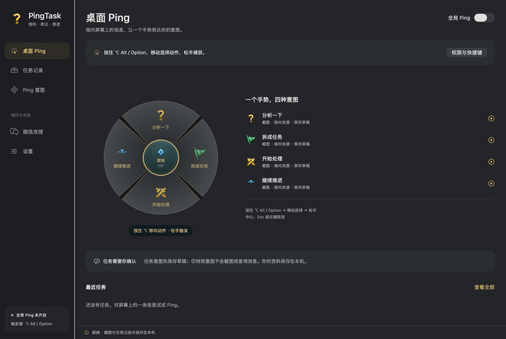
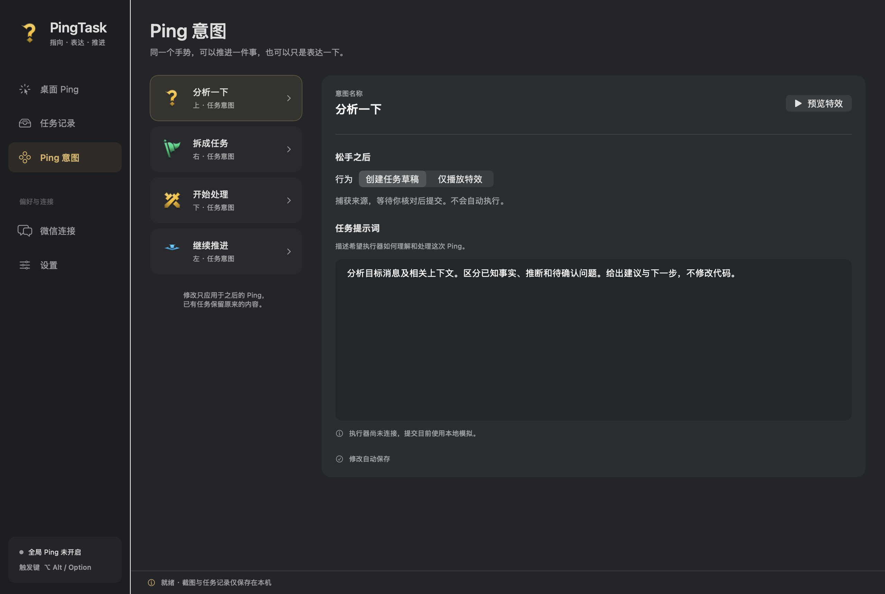
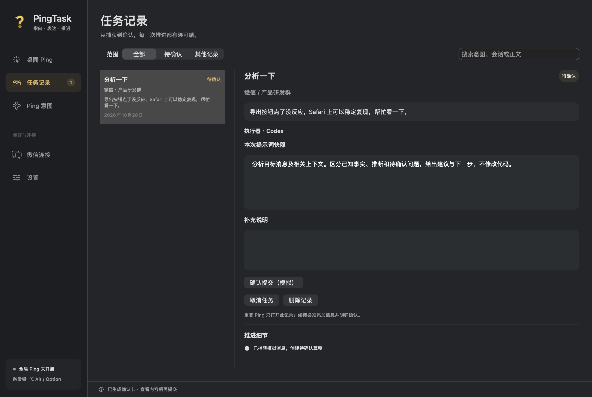
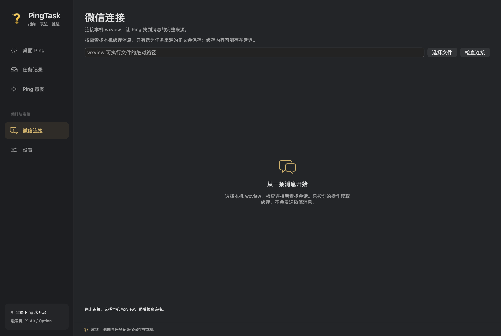
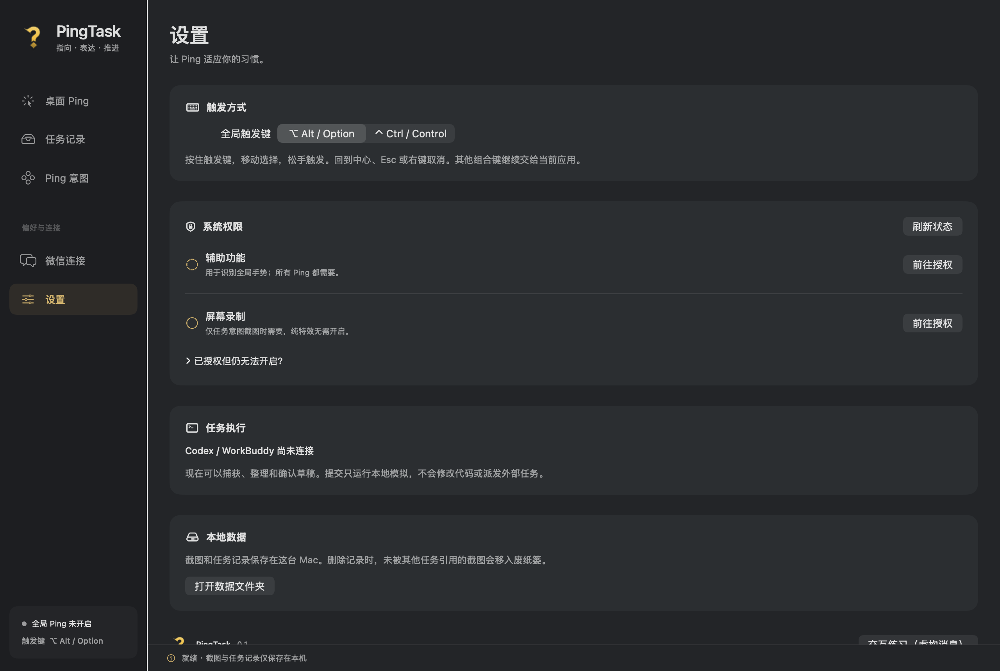

# PingTask

**指向信息，表达意图，让事情往前推进。**

一个使用 SwiftUI + AppKit 构建的原生 macOS 应用。按住 Alt / Ctrl，移动指针选择 Ping 意图，松手保存截图草稿；也可以只播放一个短暂的特效。

已实现全局轮盘、窗口截图、Vision OCR、wxview 消息候选定位和本地任务管理。**Codex / WorkBuddy 尚未接入，确认提交目前仅运行本地模拟。**



> 图片由当前原生界面离屏渲染，使用隔离存储和虚构消息，不包含真实聊天或桌面截图。图片展示不代表全局权限、真实截图和动态效果已完成实机验收。

## 五个功能入口

| 页面 | 用途 |
|---|---|
| 桌面 Ping | 开启全局手势，查看四方向意图、预览特效，核对捕获来源和最近任务 |
| 任务记录 | 搜索、筛选、编辑草稿、明确提交、续接、取消和删除 |
| Ping 意图 | 编辑动作名称与提示词，选择“创建任务草稿”或“仅播放特效” |
| 微信连接 | 检查本机 wxview，按会话与日期查找消息，手动选为任务来源 |
| 设置 | 切换 Alt / Ctrl，管理系统权限、查看执行器状态和本地数据 |

金色问号用于应用 Logo、Dock 和菜单栏；菜单栏使用独立的 **18 × 18 pt** 图标。界面采用石墨灰与金色，默认进入桌面 Ping。虚构消息的交互练习放在设置底部。

<details>
<summary>Ping 意图：任务与纯特效</summary>



</details>

<details>
<summary>任务记录：来源、确认与推进</summary>



</details>

<details>
<summary>微信连接与设置</summary>




</details>

## 安装与运行

要求 macOS 13+、Swift 6.0+ 工具链和 macOS SDK（Xcode 或 Command Line Tools）。macOS 13 的截图兼容性仍需实机验证。

```sh
git clone https://github.com/auenger/PingTask.git
cd PingTask
bash scripts/package-app.sh
open dist/PingTask.app
```

开发时可以执行 `swift run PingTask`。打包脚本生成当前机器架构的应用和问号 icns，使用本机 ad-hoc 签名；尚未提供 Universal 包、Developer ID 签名、公证或自动更新。

## 使用方式

### 桌面 Ping

1. 在“设置”选择 **Alt / Option** 或 **Ctrl / Control**，授权辅助功能。任务意图截图还需要屏幕录制权限；纯特效意图无需该权限。
2. 回到“桌面 Ping”开启全局 Ping。系统要求时重启应用；本地开发包更新后可能需要重新授权。
3. 指向信息，按住触发键并移动选择动作，松手触发。回中心、Esc、右键或其他按键取消；普通组合键继续传递给当前应用。
4. **任务意图**保存目标窗口截图，通过 OCR 和已配置的 wxview 检索消息候选。核对来源后形成可提交草稿；找不到消息时可明确保留截图来源。
5. **仅播放特效**只展示图标弹出、扩散环和约 2.2 秒的留存淡出，不截图、不 OCR、不查询微信、不创建任务。意图页的“预览特效”同样不创建任务。

默认四个意图为“分析一下、拆成任务、开始处理、继续推进”，可分别修改名称、提示词与行为。窗口边缘会调整轮盘和选择指针，结束后恢复原始指针；捕获锚点始终保持按下时的位置。

### 微信连接

1. 选择本机 `wxview` 可执行文件，点击“检查连接”。已对照的 CLI 协议版本为 0.4.0。
2. 查找群聊或联系人，明确选择会话和日期。手动读取指定日期最早的 100 条消息，有截断时显示提示，不自动翻页。
3. 选为 Ping 来源，选择意图并核对草稿。只保存选中的来源正文，候选列表不落盘。

桌面自动定位只适用于微信窗口（`com.tencent.xinWeChat`）。默认检索最近 **30 天**，每次最多 **20 条**消息，可修改日期范围（最长 366 天）。唯一标题候选可以继续自动检索，但最终消息始终由用户核对；OCR 相似度不是权威消息身份。

wxview 使用本地缓存，不保证实时或手机端完整性。当前仅支持单账号目录，查询前后复核身份。不会自动初始化密钥、读取微信进程内存、启动无关服务或推进共享 checkpoint；缓存缺失时 wxview 自身可能按其规则建立缓存。媒体不读取，来源正文上限 12000 字。

### 任务与记录

- 松手不自动派发；明确确认才提交到本地模拟执行器。
- 同一来源、动作 ID、执行器再次 Ping，打开已有记录并保留编辑；已移除项目选择和项目身份维度。
- 活跃提交期间重复点击不会生成新一轮；续接必须添加新信息并明确确认。
- 模板变更只影响新草稿；历史提示词快照不变。
- 可以取消草稿或停止本地模拟。删除记录需要确认，独占截图移入废纸篓，共享截图保留；删除不代表取消远程任务。
- 重启发现未结束的模拟执行时标记“待核对”，不自动重新提交。

轮盘的“继续推进”是可配置意图；当前真正的模拟续接在已有任务记录中操作。不能把模拟完成当成真实执行、代码改动或验证完成。

## 数据与边界

记录保存在 `~/Library/Application Support/PingTaskPrototype/state.json`，截图位于同目录的 `Captures/`。旧目录名为兼容既有数据保留。设置中可以打开数据目录。

截图只在主动触发任务意图时进行；空闲不录屏、不运行 OCR、不轮询聊天。图像最长边 4096 像素，OCR 最多 400 行。macOS 14+ 使用 SCScreenshotManager，13 使用短时 SCStream 获取一帧。

当前 JSON 存储仅适合单实例本地使用；真实执行器、事务 outbox、跨进程协调、远端幂等、完整消息前后文、飞书和钉钉适配尚未实现。权限、焦点、多屏/Retina、macOS 13 和真实微信命中率仍需实机验收。

## 开发与验证

```sh
swift build
swift run PingTask --self-test
bash scripts/package-app.sh
./dist/PingTask.app/Contents/MacOS/PingTask --self-test
codesign --verify --deep --strict dist/PingTask.app
plutil -lint dist/PingTask.app/Contents/Info.plist
```

测试使用临时存储与合成消息，覆盖身份、去重、编辑保留、提交保护、取消与删除、共享截图清理、wxview 协议和账号隔离、CLI 超时、手势状态、来源确认及真实 Vision 对合成图像的 OCR。不修改用户记录，不调用真实执行器。

重新生成文档界面图（不执行屏幕捕获）：

```sh
swift build
mkdir -p docs/images
.build/debug/PingTask --render-desktop 4 docs/images/desktop.png
.build/debug/PingTask --render-desktop 1 docs/images/intents.png
.build/debug/PingTask --render-desktop 2 docs/images/tasks.png
.build/debug/PingTask --render-desktop 3 docs/images/wechat.png
.build/debug/PingTask --render-desktop 6 docs/images/settings.png
```

提交图片前检查是否包含本机路径、账号或其他私人信息。渲染工具使用临时任务存储；连接路径和权限展示仍可能来自运行环境。

## 代码与设计

| 路径 | 职责 |
|---|---|
| `Sources/PingTask/main.swift` | 模型、Store、模拟执行、App 与命令行入口 |
| `Capture/` | 全局输入、窗口截图、捕获协调、几何与自检 |
| `Resolver/` | OCR 线索与微信候选匹配 |
| `SourceAdapter/` | wxview CLI、边界检查和隔离测试 |
| `Presentation/` | 应用导航、设置、任务、轮盘和特效 |
| `Resources/` | lolPing PNG 和上游版权说明 |
| `scripts/` | icns 生成和本机应用打包 |

`Capture/` 至 `Resources/` 的目录简写均相对于 `Sources/PingTask/`。采用 Apple 原生框架，无第三方运行时依赖。

- [产品设计](docs/01-product.md)
- [技术设计](docs/02-architecture.md)
- [确认与幂等协议](docs/03-confirmation-idempotency.md)
- [功能路线](docs/04-roadmap.md)
- [验证清单](docs/05-prototype-checklist.md)
- [开发协作约定](AGENTS.md)

## 素材来源

交互和视觉参考 [lolPing](https://github.com/darrenprx/lolPing)，按用户要求使用其 PNG 图标，没有加入音效。上游源码为 MIT，但游戏图片不在 MIT 授权范围内；完整来源与版权边界见 [THIRD_PARTY_NOTICES.md](THIRD_PARTY_NOTICES.md)。
